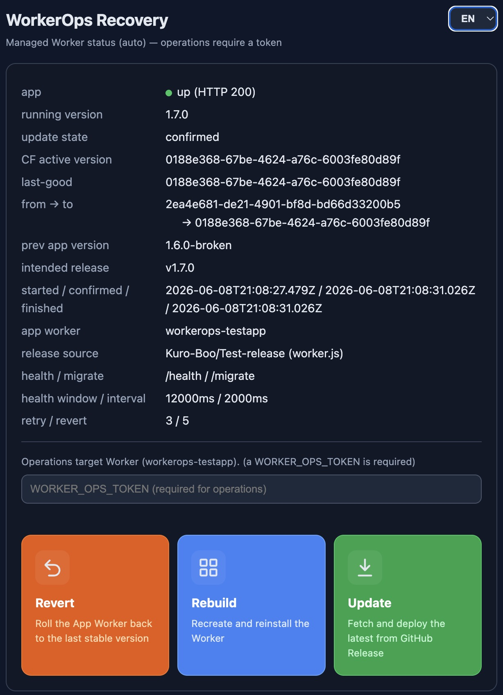

<div align="center">

# WorkerOps

**A small guardian Worker that updates your Cloudflare Worker safely, and brings it back when an update goes wrong.**

[](LICENSE.txt)
[](https://workers.cloudflare.com/)
[](#)

Signed updates · health-checked rollouts · automatic rollback · a recovery console that works when your app does not.



</div>

---

## The problem

A Cloudflare Worker cannot safely roll itself back. If a new version is broken, the code that was supposed to undo the update is broken with it. Your users see errors, and the only way out is the Cloudflare dashboard.

## The fix

WorkerOps stands in front of your app as a tiny, always-on guardian. It installs new versions, checks that they really work, and returns to the last good version on its own when they do not. Your users never have to open the Cloudflare dashboard.

- **Only signed releases.** Every version is an Ed25519-signed manifest. Each file is checked by SHA-256 and size. The exact version asked for is the only one accepted. Older versions are refused, so nobody can roll you back to a known-bad build.
- **Verified, then confirmed.** After a deploy, WorkerOps waits until the *new* version answers its health check. It does not trust the old version answering during propagation. Only then does it mark the release as good.
- **Rollback in seconds.** If the new version is unhealthy, WorkerOps returns to the last good version through the Cloudflare Versions API. Nothing is re-uploaded.
- **Hands-off updates.** Automatic updates are on by default and checked once a day. The owner can switch them off, pick a channel (`stable` or `dev`), or update right now from the console.
- **A recovery console that is always up.** One self-contained page with no external CSS or JS. It keeps working while the app is down.
- **Small and dependency-free.** No runtime dependencies. About 32 KiB gzipped.

## How it works

```
             ┌──────────────── WorkerOps (guardian) ─────────────────┐
  request ──▶│  /__workerops__/*  → recovery console & REST API        │
             │  everything else   → app (service binding)              │──▶ your app Worker
             │                                                         │
             │  cron   → watchdog · automatic updates · app minute     │
             │  update → fetch signed release → verify → deploy        │
             │           → wait for the new version's health           │
             │           → confirm, or roll back to last-good          │
             └─────────────────────────────────────────────────────────┘
```

1. **Fetch.** The release comes from the distribution endpoint (`{UPDATE_ORIGIN}/v1/dist/{PRODUCT_ID}/…`, default `https://update.entamy.com`), or from a KV namespace in your own account (`RELEASE_STORE`). There is no other source, and nothing can push a version in from outside.
2. **Verify.** WorkerOps checks the manifest signature against trusted public keys, then each artifact's digest and size. Undeclared files are refused. The version must be the one requested, and it may not be lower than the running one.
3. **Migrate.** Database migrations shipped in the release run once against `APP_DB` and are recorded in `d1_migrations`. Alternatively, the app runs its own migrations through `MIGRATE_PATH` once the new version answers. Migrations are meant to be additive.
4. **Deploy.** The new version goes live, or first goes to 0% for a trial when `TRIAL_BEFORE_DEPLOY=1`. Every step is journaled in WorkerOps' own KV, so a watchdog can finish or undo an update that was interrupted.
5. **Confirm or roll back.** A healthy new version becomes last-good. An unhealthy one is rolled back automatically.

WorkerOps never replaces itself: a broken guardian could no longer recover anything. The **app** updates its guardian instead, taking the guardian's lock (`hold`) and waiting until the new guardian answers with its version (`status`).

## The contract

Your app becomes WorkerOps-ready with one endpoint:

| | Endpoint | Purpose |
|---|---|---|
| Required | `GET {HEALTH_PATH}` | `200 {ok: true, version}`. Liveness and the running version |
| Optional | `product_id` in the health answer | The product name at the distribution endpoint, if `PRODUCT_ID` is not configured |
| Optional | `update_policy` in the health answer | `{auto, channel}`, when the owner's choice lives in the app's own admin screen. It overrides the guardian's setting |
| Optional | `POST {MIGRATE_PATH}` | Apply pending migrations (additive, backward-compatible) |

Everything else (data model, authentication, UI) stays yours.

Apps bound to the guardian can also call it over RPC (the `WorkerOpsAssets` entrypoint):

| Method | What it does |
|---|---|
| `publish(manifest, read)` | Hand over built static pages. The guardian uploads only the changed files and publishes a version with the current code, so last-good never drifts |
| `status()` / `hold(ttl)` / `release()` | Let the app replace the guardian safely (the lock lasts at most 10 minutes; an operation asked for with the token takes it over) |
| `recheck()` | Check for a newer release now, instead of waiting for the daily check |
| `restart(reason)` | Deploy the serving version again (an operator's button in the app) |

## REST API

Everything lives under `OPS_PATH` (default `/__workerops__`), so it never collides with your app's routes.

| Method | Path | Auth | Purpose |
|---|---|---|---|
| GET | `/api/v1/health` | none | Guardian liveness and version |
| GET | `/api/v1/status` | screen\* | App health and update state. With the token: also failure texts, active version, recent failures, offered release |
| GET | `/api/v1/release` | token | Offered version on the channel, and whether it is newer |
| GET | `/api/v1/auth-check` | token | Check a token without changing anything |
| POST | `/api/v1/update` | token | Install the offered (or a named) version |
| POST | `/api/v1/reinstall` | token | Install the current release again (repair) |
| POST | `/api/v1/revert` | token | Return to the last good version |
| PUT | `/api/v1/release/auto` | token | `{enabled: true\|false}` automatic updates |
| PUT | `/api/v1/release/channel` | token | `{channel: "stable"\|"dev"}` |

\* With `OPS_SCREEN=on` the recovery page and status are public, which suits installs whose owners use the page themselves. Otherwise every route except `/api/v1/health` answers `404` unless the token is presented, so a stranger cannot even tell that a guardian is there.

The token is `Authorization: Bearer <WORKER_OPS_TOKEN>`.

```bash
curl -X POST -H "Authorization: Bearer $WORKER_OPS_TOKEN" \
  https://<host>/__workerops__/api/v1/update
```

Operations return right away. `update` answers `deployed_unverified`, and verification continues in the background. Follow `state.status` in `/api/v1/status` until it reads `confirmed`, `reverted`, `failed_predeploy` or `manual_required`. A second operation while one runs gets `409 update_in_progress`.

## Recovery ladder

| Step | Use it when |
|---|---|
| 1. **Revert** to last-good | An update broke the app. Instant, nothing re-uploaded |
| 2. **Reinstall** the release | The Worker is missing or damaged |
| 3. Manual recovery | Last resort: Cloudflare dashboard or your installer |

Reinstalling is not the first move. Installing the same broken release again does not fix it.

With `APP_RESTART=1`, WorkerOps also deploys the serving version again when the app's health fails during normal operation (once per incident).

## Built for an unreliable network

- **Transient vs. permanent.** 429, 5xx, connection errors and timeouts are retried with exponential backoff and jitter, honoring `Retry-After`. Authentication and validation errors stop at once.
- **Idempotent steps.** Deploys are reconciled against the version Cloudflare actually serves. Migrations run once.
- **Version-aware checks.** Right after a deploy, a service binding may still reach the old version. WorkerOps waits for the new version to answer, so a broken release is never confirmed by its predecessor.
- **Single flight.** One update at a time; stale locks expire.

## Configuration

| Key | Kind | Purpose |
|---|---|---|
| `APP_SERVICE` | service binding | The app Worker: traffic, health checks, migrations |
| `WORKEROPS_STATE` | KV | Update state, journal and lock (no app data) |
| `APP_DB` | D1 (optional) | Target of signed release migrations |
| `RELEASE_STORE` | KV (optional) | Releases kept in your own account instead of the distribution endpoint |
| `CF_API_TOKEN` | secret | Cloudflare API token that updates and reverts the app (Workers Scripts: Edit) |
| `WORKER_OPS_TOKEN` | secret | Token for operations and, unless `OPS_SCREEN=on`, for everything else |
| `OPS_SCREEN` | secret | `on` makes the recovery page and status public |
| `CF_ACCOUNT_ID`, `APP_WORKER_NAME` | var | Which Worker to update |
| `PRODUCT_ID` | var | Product name at the distribution endpoint |
| `UPDATE_ORIGIN` | var | Distribution endpoint (default `https://update.entamy.com`) |
| `RELEASE_PUBKEYS` | var | JSON list of trusted Ed25519 keys. Required when `UPDATE_ORIGIN` points elsewhere; the default endpoint's key is built in |
| `RELEASE_CHANNEL` | var | Channel offered until the owner picks one (`stable` by default) |
| `HEALTH_PATH`, `MIGRATE_PATH`, `OPS_PATH` | var | Paths (`/health`, none, `/__workerops__`) |
| `HEALTH_OK_STATES` | var | Extra health states that count as healthy, e.g. `ok,degraded` |
| `TRIAL_BEFORE_DEPLOY` | var | `1`: try a new version at 0% before sending it traffic |
| `APP_RESTART` | var | `1`: restart the app when its health fails |
| `APP_TICK` | var | `1`: the app runs its scheduled work on the guardian's cron (`tick`), so it needs no cron of its own |
| `DEFECTS` | var | `off` stops failure reports (below) |
| `RETRY_MAX`, `REVERT_RETRY_MAX`, `HEALTH_WINDOW_MS`, … | var | Tunables (3, 5, 45 s, …) |

Bind the app's own D1, KV, R2 and assets to the **app** Worker. WorkerOps keeps none of them.

### Failure reports

When an update fails, WorkerOps sends one event to Entamy Defects (`https://defects.entamy.com`). The codes are `workerops_app_failed_predeploy`, `workerops_app_auto_reverted`, `workerops_app_manual_required`, `workerops_app_down` and `workerops_app_restarted`. A confirmed update is sent as a record (`workerops_app_updated`).

Only codes, versions and the step that failed leave the guardian. No error text, URLs, host names or account IDs are sent; the install is named by a hash. Set `DEFECTS=off` to stop the reports. A report that cannot be delivered never changes what the guardian does.

## Deploy

WorkerOps runs in front of the app, so point the app's public route at WorkerOps.

1. In `wrangler.toml`, set the `WORKEROPS_STATE` KV id, `APP_SERVICE` (your app Worker), `CF_ACCOUNT_ID`, `APP_WORKER_NAME`, `PRODUCT_ID`, `HEALTH_PATH` and your route. The default cron runs every two minutes.
2. Set the secrets:
   ```bash
   wrangler secret put CF_API_TOKEN
   wrangler secret put WORKER_OPS_TOKEN
   ```
   For `wrangler dev`, put the same values in `.dev.vars` (see `.dev.vars.example`).
3. Run `wrangler deploy`.
4. Make your app answer `GET {HEALTH_PATH}` with `{ok, version}`.

## Limits

- Workers cannot load code at run time (`eval`, remote `import()`), so updates replace the whole app version.
- Schema rollback is out of scope: keep migrations additive and backward-compatible.
- Every request takes one extra hop through the guardian (same colo, small cost).

WorkerOps guards [KuroCMS](https://github.com/Kuro-Boo/KuroCMS) sites and Entamy's own services.

## License

[Kuro License](LICENSE.txt) (MIT with attribution).

If you use WorkerOps behind a public or user-facing interface, show **`WorkerOps: Kuro.Boo`** with a link to https://kuro.boo/ in a suitable place (footer, About screen, documentation). The WorkerOps recovery console already includes it.

Copyright (c) 2026 Kuro-Boo
